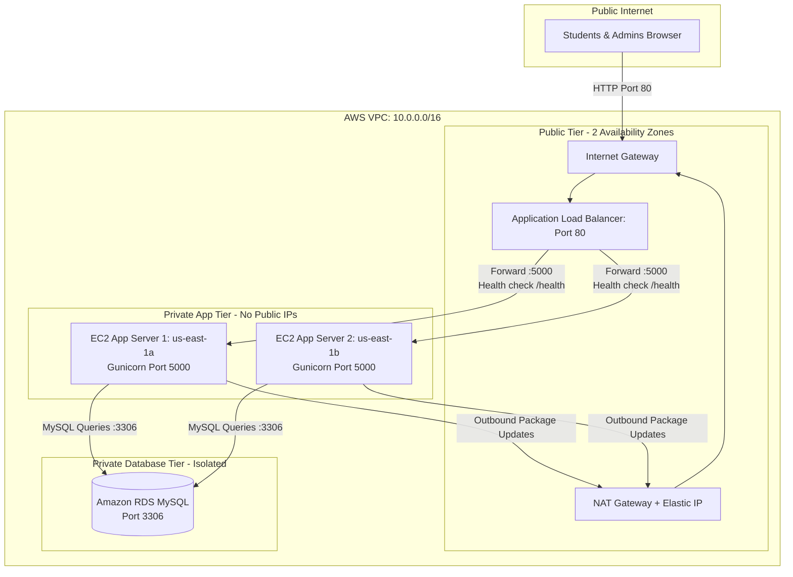

# AWS Deployment Guide: 3-Tier Highly Available CloudLibrary System

> **College Cloud Computing Project Deployment Guide**  
> **Audience:** DevOps / Cloud Engineer Teammate  
> **Goal:** Deploy the Flask + MySQL Library Management System onto AWS with high availability, isolated subnets, an Application Load Balancer, and Amazon RDS.

---

## 1. High-Level Architecture Overview

The system implements a production-grade **3-Tier Highly Available Cloud Architecture** spanning **2 Availability Zones (AZs)** inside a custom VPC:

1. **Public Tier (Web Entry):**
   - Application Load Balancer (ALB) receiving incoming HTTP traffic from the internet on Port 80.
   - NAT Gateway with an Elastic IP to allow private app instances to securely download packages without having public IP addresses.
2. **Private Application Tier:**
   - EC2 Instances running Python Flask via Gunicorn WSGI on Port 5000.
   - Instances have **NO public IP** and can only be reached through the ALB.
   - Managed via an Auto Scaling Group across `us-east-1a` and `us-east-1b`.
3. **Private Database Tier:**
   - Amazon RDS MySQL Multi-AZ / Subnet Group.
   - Completely isolated: no internet access, reachable **only** by EC2 application servers on Port 3306.

---

### Architecture Diagrams

#### Mermaid Diagram


#### ASCII Architecture Diagram
```
                     +---------------------------------------+
                     |           Public Internet             |
                     +-------------------+-------------------+
                                         |
                                         v [Port 80]
                     +---------------------------------------+
                     |        Internet Gateway (IGW)         |
                     +-------------------+-------------------+
                                         |
+----------------------------------------v-----------------------------------------+
| AWS VPC (10.0.0.0/16)                                                            |
|                                                                                  |
|  [ PUBLIC SUBNETS ] (Across 2 AZs: us-east-1a, us-east-1b)                       |
|  +-------------------------------------+   +----------------------------------+  |
|  | Public Subnet 1 (10.0.1.0/24)       |   | Public Subnet 2 (10.0.2.0/24)    |  |
|  | - Application Load Balancer (ALB)   |   | - Application Load Balancer      |  |
|  | - NAT Gateway (Elastic IP)         |   |                                  |  |
|  +------------------+------------------+   +-----------------+----------------+  |
|                     |                                        |                   |
|                     +--------------------+-------------------+                   |
|                                          | [Forward Port 5000]                   |
|                                          v                                       |
|  [ PRIVATE APP SUBNETS ] (Across 2 AZs - No Public IPs)                          |
|  +-------------------------------------+   +----------------------------------+  |
|  | Private App Subnet 1 (10.0.11.0/24) |   | Private App Subnet 2 (10.0.12/24)|  |
|  | - EC2 Instance 1 (Flask + Gunicorn) |   | - EC2 Instance 2 (Flask Gunicorn)|  |
|  +------------------+------------------+   +-----------------+----------------+  |
|                     |                                        |                   |
|                     +--------------------+-------------------+                   |
|                                          | [MySQL Port 3306]                     |
|                                          v                                       |
|  [ PRIVATE DB SUBNETS ] (Isolated Data Layer)                                    |
|  +-------------------------------------+   +----------------------------------+  |
|  | Private DB Subnet 1 (10.0.21.0/24)  |   | Private DB Subnet 2 (10.0.22/24) |  |
|  |             +-----------------------+---+-----------------------+             |
|  |             |      Amazon RDS MySQL Instance (db.t3.micro)      |             |
|  |             +---------------------------------------------------+             |
|  +----------------------------------------------------------------------------+  |
+----------------------------------------------------------------------------------+
```

---

## 2. Step-by-Step AWS Console Deployment Guide

Follow these steps **in exact sequential order**.

### STEP 1: Create the VPC & Subnets

1. Log in to the **AWS Management Console** and select your target region (e.g., `us-east-1` N. Virginia).
2. Go to **VPC Console** &rarr; click **Create VPC**.
3. Choose **VPC only**:
   - **Name tag:** `library-vpc`
   - **IPv4 CIDR block:** `10.0.0.0/16`
   - Click **Create VPC**.
4. Go to **Subnets** &rarr; click **Create subnet** for each of the 6 subnets:

| Subnet Name | VPC | Availability Zone | IPv4 CIDR Block | Type |
|---|---|---|---|---|
| `library-public-1a` | `library-vpc` | `us-east-1a` | `10.0.1.0/24` | Public (ALB / NAT) |
| `library-public-1b` | `library-vpc` | `us-east-1b` | `10.0.2.0/24` | Public (ALB) |
| `library-private-app-1a` | `library-vpc` | `us-east-1a` | `10.0.11.0/24` | Private (EC2 App) |
| `library-private-app-1b` | `library-vpc` | `us-east-1b` | `10.0.12.0/24` | Private (EC2 App) |
| `library-private-db-1a` | `library-vpc` | `us-east-1a` | `10.0.21.0/24` | Private (RDS DB) |
| `library-private-db-1b` | `library-vpc` | `us-east-1b` | `10.0.22.0/24` | Private (RDS DB) |

5. Select `library-public-1a`, click **Actions** &rarr; **Edit subnet settings** &rarr; check **Enable auto-assign public IPv4 address**. Repeat for `library-public-1b`.

---

### STEP 2: Configure Internet Gateway, NAT Gateway & Route Tables

#### A. Internet Gateway (IGW)
1. Go to **Internet Gateways** &rarr; **Create internet gateway**:
   - **Name:** `library-igw`
2. Select `library-igw` &rarr; **Actions** &rarr; **Attach to VPC** &rarr; select `library-vpc`.

#### B. NAT Gateway
1. Go to **NAT Gateways** &rarr; **Create NAT gateway**:
   - **Name:** `library-nat-gw`
   - **Subnet:** Select `library-public-1a`
   - **Elastic IP allocation ID:** Click **Allocate Elastic IP**
   - Click **Create NAT gateway** (takes ~1-2 minutes).

#### C. Route Tables
Create 3 Route Tables under **Route Tables**:

1. **`library-public-rt`**:
   - Edit routes &rarr; Add route: `0.0.0.0/0` &rarr; Target: `Internet Gateway` (`library-igw`).
   - Subnet Associations: Associate `library-public-1a` and `library-public-1b`.
2. **`library-private-app-rt`**:
   - Edit routes &rarr; Add route: `0.0.0.0/0` &rarr; Target: `NAT Gateway` (`library-nat-gw`).
   - Subnet Associations: Associate `library-private-app-1a` and `library-private-app-1b`.
3. **`library-private-db-rt`**:
   - Keep default local route (`10.0.0.0/16 local`). Do NOT add any internet route.
   - Subnet Associations: Associate `library-private-db-1a` and `library-private-db-1b`.

---

### STEP 3: Create Security Groups

Under **VPC** &rarr; **Security Groups**, create the following 3 groups with strict least-privilege rules:

#### 1. `ALB-SG` (Load Balancer Security Group)
- **VPC:** `library-vpc`
- **Description:** Allow inbound HTTP from the world to ALB
- **Inbound Rules:**
  - Type: `HTTP` | Port: `80` | Source: `Anywhere-IPv4` (`0.0.0.0/0`)
- **Outbound Rules:**
  - Allow all traffic (default).

#### 2. `EC2-SG` (Application Instances Security Group)
- **VPC:** `library-vpc`
- **Description:** Allow port 5000 only from ALB-SG
- **Inbound Rules:**
  - Type: `Custom TCP` | Port: `5000` | Source: Select `ALB-SG` (Group ID `sg-xxxxxx`)
  - *(Optional for SSH if using Bastion/CloudShell)*: `SSH` | Port: `22` | Source: Your IP
- **Outbound Rules:**
  - Allow all traffic (needed for NAT gateway to download packages and reach RDS).

#### 3. `RDS-SG` (Database Security Group)
- **VPC:** `library-vpc`
- **Description:** Allow MySQL port 3306 only from EC2-SG
- **Inbound Rules:**
  - Type: `MySQL/Aurora` | Port: `3306` | Source: Select `EC2-SG` (Group ID `sg-yyyyyy`)
- **Outbound Rules:**
  - Allow all traffic.

---

### STEP 4: Create Amazon RDS MySQL Database

1. Go to **RDS Console** &rarr; **Subnet groups** &rarr; **Create DB subnet group**:
   - **Name:** `library-db-subnet-group`
   - **VPC:** `library-vpc`
   - **Availability Zones:** Select `us-east-1a` and `us-east-1b`
   - **Subnets:** Select `10.0.21.0/24` and `10.0.22.0/24` (our private DB subnets)
   - Click **Create**.
2. Go to **Databases** &rarr; click **Create database**:
   - **Engine:** MySQL (Version: MySQL 8.0.x)
   - **Templates:** **Free Tier**
   - **DB instance identifier:** `library-db-instance`
   - **Master username:** `admin`
   - **Master password:** `AdminPassword123` *(or choose your own password and note it down)*
   - **Instance configuration:** `db.t3.micro` or `db.t4g.micro`
   - **Storage:** 20 GiB gp2/gp3, Disable storage autoscaling (for college project cost savings)
   - **Connectivity:**
     - VPC: `library-vpc`
     - DB Subnet Group: `library-db-subnet-group`
     - Public access: **No** (Strict private isolation)
     - Existing VPC security groups: Remove `default` and select `RDS-SG`
     - Availability Zone: No preference (or `us-east-1a`)
   - **Additional configuration:**
     - Initial database name: `library_db`
   - Click **Create database**.
3. **Wait ~5-7 minutes** until the status turns to **Available**.
4. Click into `library-db-instance` and copy the **Endpoint**:
   - Example: `library-db-instance.c7xxxxx.us-east-1.rds.amazonaws.com`

---

### STEP 5: Initialize the Database (`schema.sql`)

Because the RDS instance is in a private subnet, you can import `schema.sql` via:
- **Option A (Recommended & Simplest):** SSH or AWS Systems Manager Session Manager into the first EC2 instance once launched.
- **Option B (Temporary Bastion / EC2 in Public Subnet):** Launch a micro instance in `library-public-1a`, install MySQL client, and run:
```bash
mysql -h <YOUR_RDS_ENDPOINT> -P 3306 -u admin -p library_db < schema.sql
```
- **Option C (Automatic Seed Fallback):** The Flask application (`app.py`) is written to automatically verify and seed default admin (`admin` / `admin123`) and student (`student1` / `student123`) accounts as soon as tables are created!

---

### STEP 6: Create Target Group for the Load Balancer

1. Go to **EC2 Console** &rarr; **Target Groups** (under Load Balancing) &rarr; click **Create target group**.
2. **Basic configuration:**
   - **Target type:** `Instances`
   - **Target group name:** `library-target-group`
   - **Protocol:** `HTTP`
   - **Port:** `5000`
   - **VPC:** `library-vpc`
   - **Protocol version:** `HTTP1`
3. **Health checks:**
   - **Health check protocol:** `HTTP`
   - **Health check path:** `/health`
   - Expand **Advanced health check settings**:
     - Healthy threshold: `2`
     - Unhealthy threshold: `3`
     - Timeout: `5` seconds
     - Interval: `15` seconds
     - Success codes: `200`
4. Click **Next** &rarr; Click **Create target group** (we will register targets via Auto Scaling / Launch Template in Step 8).

---

### STEP 7: Create the Application Load Balancer (ALB)

1. Go to **EC2 Console** &rarr; **Load Balancers** &rarr; click **Create load balancer**.
2. Select **Application Load Balancer** &rarr; click **Create**:
   - **Load balancer name:** `library-alb`
   - **Scheme:** `Internet-facing`
   - **IP address type:** `IPv4`
3. **Network mapping:**
   - **VPC:** `library-vpc`
   - **Mappings:**
     - Select `us-east-1a` &rarr; Subnet: `library-public-1a`
     - Select `us-east-1b` &rarr; Subnet: `library-public-1b`
4. **Security groups:**
   - Remove `default` and select **`ALB-SG`**.
5. **Listeners and routing:**
   - Protocol: `HTTP` | Port: `80`
   - Default action: Forward to **`library-target-group`**.
6. Review and click **Create load balancer**.
7. Copy the **DNS name** (e.g., `library-alb-123456789.us-east-1.elb.amazonaws.com`).

---

### STEP 8: Create Launch Template & Auto Scaling Group

#### A. Create Launch Template
1. Go to **EC2 Console** &rarr; **Launch Templates** &rarr; **Create launch template**:
   - **Name:** `library-launch-template`
   - **Template version description:** `v1-flask-app`
   - **AMI:** Ubuntu Server 22.04 LTS (HVM), SSD Volume Type (64-bit x86)
   - **Instance type:** `t2.micro` or `t3.micro` (Free tier eligible)
   - **Key pair:** Optional (or select your key pair if you want SSH access)
   - **Network settings:**
     - Subnet: Don't specify in template
     - Security groups: Select **`EC2-SG`**
     - Auto-assign public IP: **Disable**
   - **Advanced details &rarr; User data:**
     Paste the content of `deploy/user_data.sh`. Make sure you update the RDS endpoint:
```bash
#!/bin/bash
set -e
exec > >(tee /var/log/user_data.log|logger -t user-data -s 2>/dev/console) 2>&1

apt-get update -y
apt-get install -y python3 python3-pip python3-venv git mysql-client

APP_DIR="/home/ubuntu/library-system"
mkdir -p "$APP_DIR"
cd "$APP_DIR"

# Clone or pull your repo (or copy files from S3)
git clone https://github.com/YOUR_GITHUB_USERNAME/YOUR_REPO_NAME.git "$APP_DIR" || true

python3 -m venv "$APP_DIR/venv"
"$APP_DIR/venv/bin/pip" install --upgrade pip
"$APP_DIR/venv/bin/pip" install -r "$APP_DIR/requirements.txt"

# Write .env configuration with your RDS values:
cat << 'EOF' > "$APP_DIR/.env"
DB_HOST=YOUR_RDS_ENDPOINT_HERE
DB_PORT=3306
DB_USER=admin
DB_PASSWORD=YourSecureRDSMasterPassword123
DB_NAME=library_db
SECRET_KEY=college-cloud-library-secret-key-change-in-production-2026
PORT=5000
FLASK_DEBUG=0
EOF

# Systemd unit configuration:
cat << 'EOF' > /etc/systemd/system/library.service
[Unit]
Description=Gunicorn instance to serve CloudLibrary Flask Application
After=network.target

[Service]
User=ubuntu
Group=ubuntu
WorkingDirectory=/home/ubuntu/library-system
EnvironmentFile=/home/ubuntu/library-system/.env
ExecStart=/home/ubuntu/library-system/venv/bin/gunicorn --workers 3 --bind 0.0.0.0:5000 app:app
Restart=always
RestartSec=5

[Install]
WantedBy=multi-user.target
EOF

chown -R ubuntu:ubuntu "$APP_DIR"
systemctl daemon-reload
systemctl enable library.service
systemctl restart library.service
```
2. Click **Create launch template**.

#### B. Create Auto Scaling Group (ASG)
1. Go to **EC2 Console** &rarr; **Auto Scaling Groups** &rarr; **Create Auto Scaling group**:
   - **Name:** `library-asg`
   - **Launch template:** Select `library-launch-template`
2. **Network:**
   - **VPC:** `library-vpc`
   - **Subnets:** Select `library-private-app-1a` and `library-private-app-1b` (Both private subnets!)
3. **Load balancing:**
   - Select **Attach to an existing load balancer**
   - Select **Choose from your load balancer target groups**
   - Select **`library-target-group`**
   - **Health checks:** Check **Turn on Elastic Load Balancing health checks**
4. **Group size and scaling policies:**
   - Desired capacity: `2`
   - Minimum capacity: `2`
   - Maximum capacity: `4`
5. Click **Next** through notifications and tags, then click **Create Auto Scaling group**.
6. The ASG will launch 2 EC2 instances, one in each private subnet across the 2 AZs.

---

## 3. Testing & Verification Checklist

Once the Auto Scaling Group launches the instances, complete this verification checklist:

- [ ] **1. NAT Gateway Route Check:** Private EC2 instances must be able to reach the internet via NAT Gateway to run `apt-get` and `pip install`.
- [ ] **2. Target Group Health Check:**
  - Go to **EC2 Console** &rarr; **Target Groups** &rarr; `library-target-group` &rarr; **Targets tab**.
  - Wait 2-3 minutes. The targets should transition from `Initial` to **`Healthy`** (HTTP 200 on `/health`).
- [ ] **3. Access the Application via ALB DNS:**
  - Paste the ALB DNS URL into your web browser:
    `http://library-alb-123456789.us-east-1.elb.amazonaws.com`
  - Verify that the homepage catalog loads with the books.
- [ ] **4. Test Health Check in Browser:**
  - Visit `http://library-alb-123456789.us-east-1.elb.amazonaws.com/health`
  - Expected JSON response:
    ```json
    {
      "database": "connected",
      "service": "Library Management System",
      "status": "healthy",
      "timestamp": "2026-10-19T14:30:00Z"
    }
    ```
- [ ] **5. Test Admin Login:**
  - Click **Login** &rarr; Click **Fill Admin** button (or enter `admin` / `admin123`).
  - Verify redirection to Admin Dashboard showing KPI metric cards.
  - Test adding a new book under **Add New Book**.
- [ ] **6. Test Student Borrowing & Late Fee Flow:**
  - Logout of admin.
  - Click **Login** &rarr; Click **Fill Student** (or enter `student1` / `student123`).
  - Go to **Borrow Books**, select an available title, and click **Borrow**.
  - Check **My Dashboard** to see the 14-day loan countdown.
  - Click **Return Book** and verify the book copy count increments by 1.

---

## 4. Troubleshooting Guide for Common AWS Deployment Issues

### Issue 1: HTTP 502 Bad Gateway from ALB
* **Cause A: Flask / Gunicorn is not running on EC2.**
  - **Resolution:** Connect to the EC2 instance and inspect systemd:
    ```bash
    sudo systemctl status library.service
    sudo journalctl -u library.service -n 50 --no-pager
    ```
* **Cause B: Gunicorn is listening only on `127.0.0.1` instead of `0.0.0.0`.**
  - **Resolution:** Verify that `ExecStart` has `--bind 0.0.0.0:5000`.
* **Cause C: Security Group mismatch.**
  - **Resolution:** Ensure `EC2-SG` allows inbound port 5000 with the source set to `ALB-SG`.

---

### Issue 2: Target Group Shows Status `Unhealthy`
* **Cause A: Health check path error.**
  - **Resolution:** Verify the target group health check path is exactly `/health` (case-sensitive).
* **Cause B: Database connection is timing out during health check.**
  - **Resolution:** Check your `.env` settings on EC2. If the DB is unreachable, PyMySQL will hang or fail. Run `curl -v http://localhost:5000/health` on the EC2 instance to read the exact response.
* **Cause C: Application started before MySQL was ready.**
  - **Resolution:** Restart the service: `sudo systemctl restart library.service`.

---

### Issue 3: Database Connection Timeout (`OperationalError: Can't connect to MySQL server`)
* **Cause A: RDS Security Group does not allow traffic from EC2.**
  - **Resolution:** Go to `RDS-SG` inbound rules. Add rule:
    - Type: `MySQL/Aurora` (3306) | Source: `EC2-SG` (`sg-xxxxxx`).
* **Cause B: RDS is in the wrong subnets.**
  - **Resolution:** Ensure the RDS DB Subnet Group contains the private DB subnets (`10.0.21.0/24` and `10.0.22.0/24`) and that the Route Table has a local route.
* **Cause C: Incorrect DB_HOST endpoint or credentials.**
  - **Resolution:** Verify `/home/ubuntu/library-system/.env` has the exact RDS endpoint without any port or `https://` prefix (e.g. `library-db-instance.xxxxx.us-east-1.rds.amazonaws.com`).

---

### Issue 4: User Data script failed to install packages
* **Cause:** Private subnets cannot route outbound traffic to download `python3-pip` or `git`.
* **Resolution:**
  - Verify that `library-private-app-rt` has a route: `0.0.0.0/0` &rarr; `library-nat-gw`.
  - Check the User Data execution log on EC2:
    ```bash
    sudo cat /var/log/user_data.log
    ```
